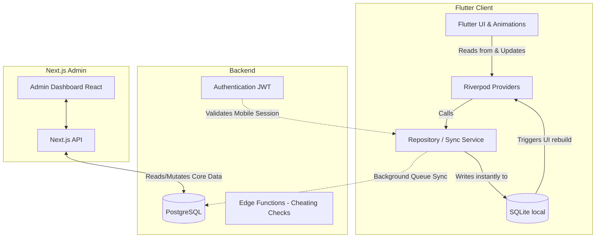

# Product Requirements Document (PRD)
**Project:** Streak App
**Document Version:** 2.0 (Detailed Draft)

> 📝 **How to add your comments to this file:**
> Since this is a Markdown file, you can type directly into the document to leave your thoughts. Under each major section, I have added a `[YOUR COMMENTS HERE]` block for you to easily jot down feedback, changes, or questions.

---

## 1. Executive Summary & Product Vision

### 1.1. Product Vision
**Streak** is designed to be the ultimate gamified habit-building and learning application. Drawing heavy inspiration from highly engaging platforms like Duolingo, the app leverages proven psychological hooks—such as visual progression via a Skill Tree, daily streak counters, and a punishing-yet-rewarding "Hearts" (lives) system—to drive massive user retention and daily active usage. 

### 1.2. Tech Stack Overview
*   **Mobile Client:** Flutter (iOS & Android)
*   **State Management:** Riverpod (Code generation via `riverpod_annotation`)
*   **Local Database (Offline-First):** SQLite (via `sqflite`)
*   **Backend & Authentication:** Supabase (PostgreSQL, Auth)
*   **Monetization:** Google Mobile Ads
*   **Admin Dashboard:** Next.js (React)

> 📝 **Comments / Feedback on Vision & Stack:**
> [YOUR COMMENTS HERE]

---

## 2. Detailed User Personas

1.  **The Aspirational Self-Improver:** 
    *   **Pain Point:** Wants to learn a language, code, or build a habit but drops off after 3 days.
    *   **Hook:** Daily push notifications, fear of breaking a streak, and the satisfaction of filling up a progress bar.
2.  **The Completionist Gamer:** 
    *   **Pain Point:** Finds standard task managers boring.
    *   **Hook:** Unlocking every node on the skill tree, achieving "Legendary/Perfect" status on lessons, and hoarding in-game currency.
3.  **The System Administrator:** 
    *   **Pain Point:** Needs to manage bad actors, monitor server loads, and tweak gamification parameters without releasing app updates.
    *   **Hook:** A robust Next.js web dashboard that hooks directly into the Supabase PostgreSQL database.

> 📝 **Comments / Feedback on Personas:**
> [YOUR COMMENTS HERE]

---

## 3. Core Features & Functional Requirements

### 3.1. The Gamification Engine (The Core Loop)

#### A. Hearts / Lives System (`app_lifecycle_heart_handler.dart`)
*   **Mechanic:** Users start with a max cap of 5 hearts. Making a mistake in a lesson or missing a daily habit deducts 1 heart.
*   **Regeneration:** Hearts regenerate at a set interval (e.g., 1 heart every 4 hours).
*   **Empty State:** If a user reaches 0 hearts, they cannot start new lessons unless they wait, watch an Ad, or spend Gems.
*   **Offline Handling:** The heart regeneration timer must be calculated locally based on the device's clock when the app returns from the background, then synced to Supabase.

#### B. The Top Bar HUD (`top_bar_hud.dart`)
*   **UI Elements:** Persistent across the app. Displays:
    1.  **Streak Flame:** Current day streak. Gray if today's goal isn't met, bright orange/animated if met.
    2.  **Hearts:** Current heart count. Pulses red when low.
    3.  **Gems/Currency:** Current balance.

#### C. Streaks & Calendar (`table_calendar`)
*   **Mechanic:** Tracking consecutive days the user has completed at least one node/lesson.
*   **Forgiveness:** "Streak Freezes" can be purchased with Gems to protect a streak if a user misses a day.

> 📝 **Comments / Feedback on Gamification:**
> [YOUR COMMENTS HERE]

---

### 3.2. The Skill Tree Progression (`skill_tree_node_builder.dart`)

#### A. Structure
*   **Pathing:** Nodes are arranged in a vertical scrolling path. Users must complete Node A to unlock Node B and C.
*   **Visual States:**
    *   *Locked:* Grayed out, unclickable, lock icon.
    *   *Active/Next:* Bouncing, colorful, pulsing glow.
    *   *Completed:* Golden/Colored, displaying a crown or star count.
    *   *Legendary:* A shattered, glowing state indicating the user has mastered this node.

#### B. Animations & "Juiciness" (`flutter_animate` & `duolingo_button.dart`)
*   Buttons must have a physical, 3D feel. Pressing a node compresses it downwards (Y-axis translation) and changes its shadow to simulate depth.
*   Completing a node triggers an explosion of confetti or stars using a particle emitter.

> 📝 **Comments / Feedback on Skill Tree:**
> [YOUR COMMENTS HERE]

---

### 3.3. Offline-First Architecture & Sync (`sync_service.dart`)

#### A. Local-First Strategy
*   Every action (completing a node, losing a heart) is written **immediately** to the local SQLite database.
*   The Riverpod UI state reacts only to the local SQLite database, resulting in a 0ms latency UI.

#### B. Cloud Synchronization
*   A background Sync Service monitors network connectivity (via `connectivity_plus`).
*   When online, a queue of local mutations is batched and sent to Supabase.
*   **Conflict Resolution:** Last-write-wins based on timestamps, prioritizing the server timestamp to prevent users from cheating the clock to gain hearts.

> 📝 **Comments / Feedback on Offline Sync:**
> [YOUR COMMENTS HERE]

---

### 3.4. Monetization Strategy (`google_mobile_ads`)

*   **Heart Refills (Rewarded Ads):** When out of hearts, prompt: "Watch a short video to get 1 Heart, or wait 4 hours."
*   **End-of-Lesson Multiplier (Rewarded Ads):** Upon finishing a node, user earns 10 Gems. Prompt: "Watch Ad to double your gems!"
*   **Banner Ads:** Placed sparingly at the bottom of the Skill Tree view for non-premium users.

> 📝 **Comments / Feedback on Monetization:**
> [YOUR COMMENTS HERE]

---

### 3.5. Next.js Admin Dashboard (`admin_dashboard`)

*   **Authentication:** Restricted strictly to Supabase users with `role: 'admin'`.
*   **User Management:** Search users by email/ID, view their streak count, ban/suspend accounts, reset passwords.
*   **Economy Tweaking:** Ability to modify global variables (e.g., how much a Streak Freeze costs, how fast hearts regenerate) directly from the web dashboard.

> 📝 **Comments / Feedback on Admin Dashboard:**
> [YOUR COMMENTS HERE]

---

## 4. Technical Architecture Diagram

---

## 5. Proposed Database Schema (High-Level)

### Supabase `users` Table
*   `id` (UUID, PK)
*   `email` (String)
*   `current_hearts` (Int)
*   `max_hearts` (Int)
*   `last_heart_regen_time` (Timestamp)
*   `current_streak` (Int)
*   `gem_balance` (Int)

### Supabase `user_progress` Table
*   `id` (UUID, PK)
*   `user_id` (UUID, FK)
*   `node_id` (String)
*   `status` (Enum: locked, active, completed, legendary)
*   `completion_timestamp` (Timestamp)

> 📝 **Comments / Feedback on Technicals:**
> [YOUR COMMENTS HERE]

---

## 6. Future Roadmap (V2 and beyond)
1.  **Social Leagues:** Putting users into random groups of 30 where they compete for the most XP in a week (Bronze, Silver, Gold leagues).
2.  **Widgets:** iOS and Android home screen widgets displaying current streaks and hearts.
3.  **Premium Subscription:** "Streak Plus" to remove ads and grant infinite hearts via in-app purchases.

> 📝 **Comments / Feedback on Roadmap:**
> [YOUR COMMENTS HERE]
